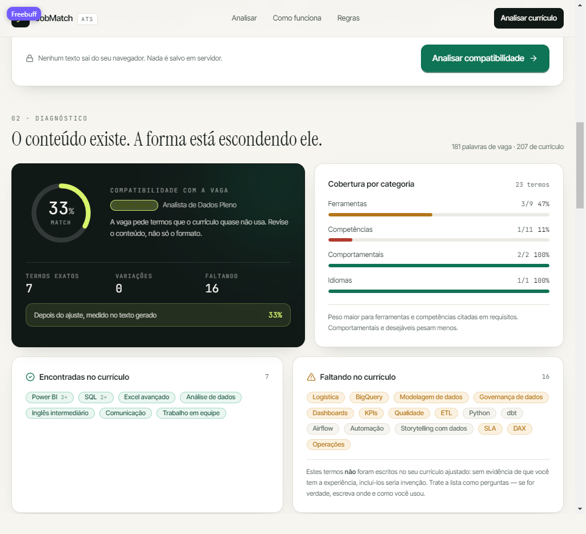
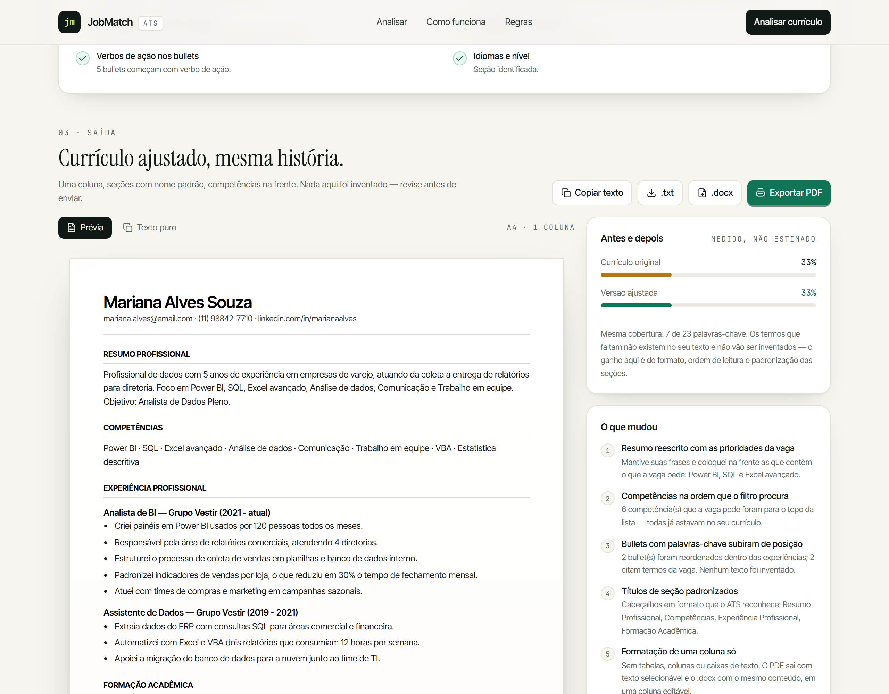

# JobMatch ATS

**Seu currículo na linguagem da vaga — sem inventar nada.**

Aplicação web que compara um currículo com uma descrição de vaga, mostra o match ATS, as
palavras-chave encontradas e as que faltam, e gera uma versão ATS friendly do mesmo currículo,
pronta para exportar em PDF.

- **Aplicação publicada:** https://site-0df3233230d442dea671950c6835f534.freebuff.page
- **Mega prompt:** [`PROMPT.md`](./PROMPT.md) (também inline neste README, no bloco “O mega prompt”)
- **Stack:** React 18 + TypeScript + Vite + Tailwind CSS + componentes no padrão shadcn/ui
- **Privacidade:** 100% no navegador. Nenhum currículo é enviado, nenhuma chave de API, nenhum banco.



---

## Qual problema a aplicação resolve

Quem procura vaga manda o mesmo currículo para todas as empresas. Do outro lado, o ATS (Application
Tracking System) lê o arquivo antes de qualquer pessoa: ele extrai texto, procura palavras do
anúncio e ranqueia. Um currículo bom, escrito com as palavras da própria pessoa (“painéis de
vendas”, “suporte por chat”), pode ficar abaixo de um currículo mediano que simplesmente usa os
termos do anúncio (“dashboards”, “customer success”).

O JobMatch ATS fecha essa distância em quatro passos:

1. a pessoa cola a descrição da vaga;
2. cola o próprio currículo;
3. vê o match, as palavras-chave encontradas e as que faltam, mais um diagnóstico de formato;
4. recebe uma versão ajustada — mesma história, vocabulário alinhado — e exporta em PDF.

E a regra que vale para o app inteiro: **ele melhora como a pessoa se apresenta, nunca inventa
experiência que a pessoa não tem.** Por isso o app é construído em cima de três decisões visíveis:

- nenhuma palavra-chave ausente é escrita no currículo gerado; ela vai para a lista “Ficou de fora”,
  com uma pergunta de como preencher aquilo **se for verdade**;
- cargos, empresas, datas, formação e idiomas do currículo original são preservados literalmente;
- quando a versão ajustada não ganha cobertura de palavras-chave, a interface diz isso em vez de
  inventar um número; o ganho, nesse caso, é de formato e ordem de leitura.

---

## Rodando localmente

```bash
npm install
npm run dev        # http://localhost:5173
npm run build      # typecheck + build de produção em dist/
npm run preview    # serve o build
```

Scripts de diagnóstico do motor (imprimem a análise de ponta a ponta no terminal):

```bash
npx esbuild scripts/eval-engine.ts --bundle --platform=node --format=esm --outfile=.eval.mjs && node .eval.mjs
npx esbuild scripts/debug-parse.ts  --bundle --platform=node --format=esm --outfile=.debug.mjs && node .debug.mjs
```

---

## Como a análise funciona: da vaga colada até o currículo ajustado

Tudo é determinístico e roda no navegador, sem chamada de modelo. O motor está em
[`src/lib/analyze.ts`](src/lib/analyze.ts) (extração, score, checagens), [`src/lib/parseResume.ts`](src/lib/parseResume.ts)
(leitura do currículo) e [`src/lib/generate.ts`](src/lib/generate.ts) (versão ajustada).

### 1. A vaga vira um vocabulário com pesos

- O texto é normalizado (minúsculas, sem acento, preservando `.`, `/`, `+`, `#` para `node.js`,
  `ci/cd`, `c++`).
- Um léxico curado de ~200 termos do mercado brasileiro reconhece expressões de várias palavras:
  “gestão de projetos”, “power bi”, “análise de dados”, “customer success”, “inglês intermediário”.
- Termos específicos do anúncio entram por extração estatística: siglas (2–6 letras maiúsculas) e
  palavras que se repetem, fora das stopwords.
- O anúncio é segmentado em **requisitos**, **desejáveis** e **benefícios**. Benefícios são
  descartados (vale-refeição não é competência); desejáveis pesam menos (fator 0,6).
- Peso final = peso da categoria (ferramenta/competência 3, certificação 2,4, formação/idioma 2,
  comportamental 1,6) × fator do segmento × fator de repetição.

### 2. O currículo é lido por seções

O parser reconhece títulos comuns em português (e alguns em inglês), com ou sem markdown, em
maiúsculas ou minúsculas: resumo/objetivo/perfil, competências/habilidades/skills, experiência
profissional, formação acadêmica, idiomas, cursos e certificações, projetos, informações adicionais.
Cabeçalho, e-mail, telefone, links e cidade são extraídos por padrão. Experiências são divididas por
linha em branco **ou** por linha de período (“2021 - 2024”), e bullets com `-`, `•`, `●`, `*`, `·`
são reconhecidos — currículo colado de PDF costuma perder essas marcações.

### 3. Cada palavra-chave é comparada com o currículo

| Situação | Cobertura | Como aparece na tela |
|---|---|---|
| A frase exata existe | 100% | chip verde “encontrada”, com contagem de ocorrências |
| 60%+ das palavras do termo existem (plural/variação) | 60% | chip marcado como variação |
| Nada encontrado | 0% | chip âmbar em “Faltando no currículo” |

### 4. O score

```
match = Σ (peso × fator_requisito × cobertura)
        ──────────────────────────────────────── × 100
        Σ (peso × fator_requisito)
```

O resultado é arredondado e lido em faixas: `<40` baixo, `40–59` parcial, `60–79` bom, `≥80` forte.
É **cobertura lexical**: mede vocabulário e formato, não competência profissional — e o app diz
isso na própria interface.

### 5. Checagens de formato (a parte que o ATS lê antes do conteúdo)

E-mail, telefone com DDD, LinkedIn/portfólio, seção de resumo, seção de experiência, formação,
lista de competências, bullets, datas, tamanho (ideal 350–800 palavras), ausência de tabelas,
colunas e emojis, números nos resultados, verbos de ação, idiomas. Cada item tem peso e status
aprovado/atenção/falha, e o conjunto vira uma nota de 0 a 100.

### 6. A versão ajustada

1. **Cabeçalho:** nome + contato em uma linha, sem tabela.
2. **Resumo Profissional:** frases do resumo original, priorizando as que já contêm termos da vaga;
   depois “Foco em …” com competências **presentes no currículo** e “Objetivo: {cargo da vaga}”.
3. **Competências:** primeiro o que a vaga pede e o currículo comprova (usando a grafia que a pessoa
   escreveu), depois o restante. Idiomas e formação ficam nas suas próprias seções.
4. **Experiência:** cargos, empresas e datas intactos; bullets reordenados por relevância para a
   vaga (ordenação estável). Nenhum fato é reescrito.
5. **Formação, certificações, idiomas, projetos:** conteúdo preservado, títulos padronizados.
6. **Medição de novo:** o score é recalculado sobre o texto gerado e comparado com o original.
7. **Registro:** “O que mudou” lista as decisões em linguagem humana; “Ficou de fora” lista os
   termos ausentes com uma dica por categoria.

### Exemplo real (dados de demonstração do próprio app)

| Caso | Palavras-chave | Match antes | Match depois | Formato ATS |
|---|---|---|---|---|
| Analista de dados (logística) | 23 | 33% | 33% (mesma cobertura: os termos que faltam não existem no texto) | 96/100 |
| Customer Success (SaaS) | 17 | 43% | 51% | 94/100 |

O primeiro caso é o exemplo mais honesto do produto: o currículo realmente não fala BigQuery, dbt,
Airflow nem governança de dados. O app mostra as lacunas, padroniza as seções e **não** escreve
nada que a pessoa não tenha vivido.

---

## O mega prompt

O projeto nasceu de um prompt único em Markdown que descreve a aplicação inteira — problema, regras,
telas, algoritmo, design system, critérios de aceite. O arquivo completo está em
[`PROMPT.md`](./PROMPT.md); a versão integral está reproduzida abaixo.

```text
# Mega prompt — JobMatch ATS

Este é o prompt único que descreve a aplicação inteira. É o documento de origem do projeto:
tudo o que está no app veio daqui (ou foi ajustado aqui depois de ver a primeira versão rodando —
as mudanças estão registradas no `README.md`).

---

## 1. Papel e objetivo

Você é um time de produto e engenharia sênior. Construa uma aplicação web chamada **JobMatch ATS**
que resolve um problema concreto: currículos bons são descartados por sistemas de triagem (ATS)
antes de qualquer pessoa do RH ler. A aplicação compara um currículo com uma descrição de vaga,
mostra o quanto ele bate com o anúncio e devolve uma versão do mesmo currículo otimizada para
leitura por ATS.

O aplicativo precisa funcionar de ponta a ponta no navegador, sem backend obrigatório, e caber
em uma sessão de trabalho: colar, analisar, revisar, exportar.

## 2. A regra que não se negocia

> A ferramenta melhora **como a pessoa se apresenta**. Ela nunca inventa experiência.

Consequências obrigatórias, visíveis na interface e no código:

- Nunca criar cargos, empresas, datas, certificações, idiomas ou resultados que não estejam no
  texto original do currículo.
- Nunca escrever uma palavra-chave que falta no corpo do currículo gerado. Palavras-chave ausentes
  aparecem em uma seção separada chamada **“Ficou de fora”**, com uma pergunta/dica de como
  preencher aquilo caso seja verdade.
- O que falta e o que foi mudado são mostrados de forma explícita, termo por termo.
- Se a versão otimizada não ganhar cobertura de palavras-chave, a interface diz isso com todas as
  letras — não infla número, não inventa “+37%”.

## 3. Público e problema

- Pessoas procurando emprego no Brasil, de primeiro emprego a pleno/sênior, que enviam o mesmo
  currículo para todas as vagas.
- Elas não sabem por que são descartadas, não sabem o vocabulário do ATS e não têm tempo de
  reescrever o currículo para cada anúncio.
- O que elas precisam ver: “seu currículo cobre 33% do que a vaga pede; estes 12 termos faltam;
  esta é a versão organizada para o filtro ler; exporte em PDF”.

## 4. Escopo

### Dentro do MVP (obrigatório)

1. Campo para colar a descrição da vaga e campo para colar o currículo.
2. Validação amigável e contagem de palavras em cada campo.
3. Botão de exemplo com um par vaga/currículo realista em português, para demonstrar em 5 segundos.
4. Score de compatibilidade de 0 a 100, com leitura qualitativa (baixo / parcial / bom / forte).
5. Cobertura por categoria (ferramentas, competências, comportamentais, certificações, formação,
   idiomas).
6. Lista de palavras-chave **encontradas** (com marcação de variação) e **faltando**
   (com marcação de requisito × diferencial).
7. Diagnóstico de formato para ATS: contato, seções reconhecíveis, bullets, datas, tamanho,
   ausência de tabelas/colunas/emojis, números nos resultados, verbos de ação, idiomas.
8. Currículo ATS friendly gerado, em prévia paginada, com seções padrão e uma coluna.
9. Exportação em PDF via impressão do navegador (texto selecionável), cópia do texto puro e
   download em `.txt`.
10. Registro do que mudou (“O que mudou”) e recálculo do score no texto gerado (“antes e depois”).
11. Página explicativa: como o match é calculado, o que a ferramenta nunca faz, limitações.

### Fora de escopo (não implementar agora)

Login, banco de dados, histórico de análises, integrações, painel administrativo, upload de PDF,
multiusuário, exportação `.docx`. O app deve deixar claro que o processamento é local e não guarda
currículo.

## 5. Fluxo e telas

### Tela única, em blocos, com rolagem (não é SPA de rotas)

**A. Cabeçalho**
- Marca “JobMatch ATS” (wordmark simples, sem imagem externa).
- Navegação: Analisar · Como funciona · Regras.
- CTA secundário “Analisar currículo” que rola até o formulário.

**B. Hero**
- Declaração do problema em uma frase forte: “Currículo bom que nunca chega ao RH, porque o filtro
  barrou antes.”
- Subtexto com o que acontece em seguida (colar → ver match → exportar).
- Dois botões: primário “Começar a análise”; secundário “Ver como a conta é feita”.
- Cartão de exemplo à direita mostrando um recorte de saída (match, termos encontrados e faltando),
  rotulado como exemplo ilustrativo.
- Faixa com a regra da casa (nunca inventar), com ícone de escudo.

**C. Entrada (workbench)**
- Título de seção com passo “01 · Entrada”.
- Dois campos lado a lado em desktop, empilhados no mobile, com rótulos “Descrição da vaga” e
  “Seu currículo”, placeholder explicativo, contagem de palavras e dica de preenchimento.
- Ações: “Carregar exemplo” e “Limpar”.
- Rodapé do cartão: aviso de privacidade (“nenhum texto sai do navegador”) e CTA
  “Analisar compatibilidade”. Erros de validação aparecem junto ao CTA.

**D. Diagnóstico**
- Cabeçalho “02 · Diagnóstico” com frase que reage ao score.
- Cartão escuro com score em anel, rótulo qualitativo, frase de leitura, contagem de termos exatos /
  variações / faltando e a projeção “depois do ajuste, medido no texto gerado”.
- Cartão de cobertura por categoria, com barras e contagens `encontrados/total`.
- Dois cartões de palavras-chave: “Encontradas no currículo” (chips, contagem de ocorrências,
  variação marcada) e “Faltando no currículo” (chips âmbar para requisito, neutros para diferencial),
  com o aviso de que nada disso foi escrito no currículo por você.
- Cartão “Leitura do ATS” com nota 0–100 e lista de checagens aprovadas/atenção/falha + dica.

**E. Saída**
- Cabeçalho “03 · Saída” com a frase “Currículo ajustado, mesma história.”
- Ações: Copiar texto · Baixar `.txt` · **Exportar PDF** (primário).
- Abas “Prévia” e “Texto puro”.
- Prévia em folha branca A4, com tipografia de documento (não de site): nome, contato em uma linha,
  seções “Resumo Profissional”, “Competências”, “Experiência Profissional”, “Formação Acadêmica”,
  “Cursos e Certificações”, “Idiomas”, “Projetos”.
- Coluna lateral: “Antes e depois” (barras + nota de como foi medido), “O que mudou” (lista numerada
  do que o gerador fez) e “Ficou de fora” (termos ausentes + dica, com aviso de que não foram
  incluídos por falta de evidência).
- Instrução de impressão: “Salvar como PDF”, desativar cabeçalho/rodapé do navegador, texto
  selecionável.

**F. Como funciona**
- Três passos objetivos do fluxo interno.
- Bloco “Como o match é calculado” com a fórmula e as regras de peso.
- Bloco “A regra que não se negocia” com três proibições explícitas e nota de privacidade.

**G. Rodapé**
- Marca, links de seção e a nota técnica (React + Vite, roda no navegador).

## 6. Motor de análise (algoritmo)

Tudo determinístico, local, sem chamadas de API e sem chave.

### 6.1 Preparação do texto
- Normalizar: minúsculas, remover acentos (NFD), colapsar espaços, preservar `.`, `/`, `-`, `+`, `#`
  (para `node.js`, `ci/cd`, `c++`, `c#`).
- Tokenizar sem stopwords em português e inglês.

### 6.2 Extração de palavras-chave da vaga
1. **Léxico curado** de ~200 termos de mercado brasileiro, com categorias: ferramenta, competência,
   comportamental, certificação, formação, idioma. Inclui expressões de várias palavras
   (“gestão de projetos”, “power bi”, “análise de dados”, “customer success”).
2. **Extração estatística** para o que o léxico não cobre: tokens do anúncio com 2+ ocorrências ou
   siglas (2–6 letras maiúsculas), fora das stopwords e fora do que já está coberto por uma
   expressão do léxico. Esses termos entram como competências/ferramentas com peso menor.
3. **Segmentação do anúncio** por títulos: responsabilidades/requisitos (peso cheio), desejáveis
   (peso reduzido) e benefícios (**descartados**).
4. **Peso final** = peso da categoria × fator do segmento × fator de repetição (limitado).
5. Limitar a ~30 termos, priorizando requisitos, e remover termos contidos em outros mais longos.

### 6.3 Correspondência
- Frase exata no currículo normalizado → cobertura 1,0 (conta ocorrências com fronteira de palavra).
- Variação: 60% ou mais dos tokens do termo presentes (tolerando plural/variações curtas, ex.:
  “competência/competências”) → cobertura 0,6, marcada como **variação**.
- Nenhuma correspondência → ausente.

### 6.4 Score
```
match = Σ (peso × fator_requisito × cobertura) / Σ (peso × fator_requisito) × 100
```
- `fator_requisito`: requisito = 1, diferencial = 0,6.
- Arredondar para inteiro. Faixas: <40 baixo, 40–59 parcial, 60–79 bom, ≥80 forte.
- Exibir sempre o número e a frase que explica o que ele significa.

### 6.5 Checagens de formato (ATS health)
Cada item com peso e status aprovado/atenção/falha:
e-mail, telefone com DDD, LinkedIn/portfólio, seção de resumo, seção de experiência, formação,
lista de competências, bullets (3+), datas (2+ anos), tamanho (ideal 350–800 palavras),
sem tabelas/colunas/emojis, números nos bullets, verbos de ação no início dos bullets, idiomas.
Nota final = soma ponderada dos aprovados / total.

### 6.6 Parser do currículo
- Reconhecer títulos de seção em português (e alguns em inglês), com ou sem markdown, maiúsculas ou
  minúsculas: resumo/objetivo/perfil, competências/habilidades/skills, experiência profissional,
  formação acadêmica, idiomas, cursos e certificações, projetos, informações adicionais.
- Cabeçalho = linhas antes do primeiro título: nome, e-mail, telefone, links, cidade.
- Experiência: dividir em blocos por linha em branco ou por linha de período (ex.: “2021 - 2024”),
  separando linhas de identificação, bullets e parágrafos.
- Resistir a currículos colados de PDF: bullets com `-`, `•`, `●`, `*`, `·`, numeração.

## 7. Geração do currículo ajustado

1. **Cabeçalho**: nome + contato em uma linha, sem tabela.
2. **Resumo Profissional**: reutilizar frases do resumo original, priorizando as que contêm termos
   da vaga, cortadas para ~300 caracteres; acrescentar “Foco em …” com competências da vaga
   **presentes** no currículo e “Objetivo: {cargo da vaga}”. Se não havia resumo, montar apenas com
   competências comprovadas no texto.
3. **Competências**: lista única, primeiro o que a vaga pede e o currículo comprova, depois o resto
   das competências originais; sem duplicatas; idiomas e formação **não** entram aqui.
4. **Experiência**: manter cargos, empresas e datas exatamente como estão; reordenar bullets por
   relevância para a vaga (ordenação estável). Não reescrever fatos.
5. **Formação, certificações, idiomas, projetos**: preservar o conteúdo, padronizar o título.
6. **Saída em texto puro** para copiar/baixar + prévia renderizada.
7. **Recalcular** o score sobre o texto gerado e exibir “antes/depois”.
8. **Registrar** as mudanças em linguagem humana (“3 bullets com palavras-chave subiram de posição”)
   e listar os termos que ficaram de fora com uma dica por categoria.

## 8. Design system — shadcn/ui + paleta

Usar **shadcn/ui** como base de componentes (Button, Card, Badge, Textarea, Progress,
Tabs/segmented control, Tooltip, Separator, Alert), com `class-variance-authority`, `clsx`,
`tailwind-merge` e a convenção `cn()`. Sem tema pronto de marketplace: paleta própria.

### Paleta

| Token | Hex | Uso |
|---|---|---|
| paper | `#F6F5F0` | fundo da página (papel) |
| surface | `#FFFFFF` | cartões |
| line | `#E4E1D8` | bordas e divisores |
| ink | `#111917` | texto principal, seções escuras |
| ink-soft | `#2C3A35` | texto secundário |
| ink-muted | `#5F6B65` | legendas e metadados |
| brand-500 | `#0F7355` | ação primária, acertos |
| brand-600 | `#0B5C44` | hover da primária |
| brand-50 | `#EAF6F0` | fundo de chips de acerto |
| signal-lime | `#D8F46B` | destaque sobre fundo escuro (score, CTA no hero) |
| signal-amber | `#B4761A` | atenção, palavras-chave faltando |
| signal-danger | `#B23A2E` | falhas |

### Tipografia
- Texto: **Inter Tight** (fallback Inter, system-ui).
- Display/títulos: **Instrument Serif** — dá tom editorial de documento, não de dashboard genérico.
- Rótulos, números e metadados: **JetBrains Mono**, caixa alta, `letter-spacing` 0.16em.

### Layout e acabamento
- Container máximo 1152px, gutters de 20px, grid de 12 colunas.
- Raio: 8px (chips), 12px (botões), 16px (cartões), 2px (folha do currículo).
- Sombra de cartão sutil (2 camadas) e sombra de página na folha A4.
- Seções escuras com textura de pontos (`radial-gradient`), não com imagens.
- Números grandes em fonte mono, sempre acompanhados de rótulo.
- Movimento discreto: fade/rise de 0,5s ao revelar resultado; barras animam a largura.
- Mobile first: uma coluna, cartões empilhados, ações em largura total.

### Impressão
- `@page A4`, margem 14mm; esconder tudo que não é a folha; texto 11,5pt preto; `break-inside:
  avoid` por experiência; sem sombra/borda na folha.

## 9. Copy e tom

- Português do Brasil, direto, sem jargão de RH e sem promessa mágica.
- Frases curtas; a interface explica o porquê de cada número.
- Nunca dizer “aumente suas chances em X%”. Dizer o que foi medido.
- Verbos no imperativo nas ações: “Cole”, “Analise”, “Exporte”.
- A regra de honestidade aparece pelo menos duas vezes: no hero e na saída.

## 10. Estados e erros

- Vazio: bloco tracejado “Aguardando análise” explicando o que vai aparecer.
- Validação: vaga < 120 caracteres ou currículo < 200 caracteres → mensagem específica, sem bloquear
  a digitação.
- Currículo sem seções reconhecidas: gerar com o que existe, mostrando as checagens falhando.
- Vaga sem termos reconhecidos: categoria vazia com explicação, não tela em branco.
- Zero ganho de cobertura: dizer que a cobertura é a mesma e que o ganho é de formato.
- Falha ao copiar: fallback silencioso; se falhar, não mostrar “copiado”.

## 11. Acessibilidade

- Contraste AA em texto e chips; foco visível com anel `#0F7355`.
- Todos os campos com `label`/`aria-label`; botões com nome acessível.
- Abas com `aria-pressed`; ícones decorativos com `aria-hidden`.
- Nada essencial depende só de cor: status tem ícone + texto.
- Navegação por teclado em todo o fluxo, inclusive exportação.

## 12. Privacidade e técnica

- 100% client-side: nenhum currículo enviado, nenhuma chave de API, nenhum analytics com PII.
- React + TypeScript + Vite, Tailwind CSS, shadcn/ui. Build estático.
- Nenhum dado persistido; recarregar limpa a sessão (e a interface avisa).
- Sem dependência de backend para o núcleo.

## 13. SEO e GEO

- `<title>` e `meta description` em português com o problema (“ATS”, “currículo”, “palavras-chave”).
- Open Graph e Twitter card com imagem 1200×630.
- JSON-LD `WebApplication` com `featureList` e oferta gratuita.
- Conteúdo textual explicando o método (bom para busca e para citação por IA).
- `lang="pt-BR"`, headings em ordem, links internos com âncora.

## 14. Critérios de aceite

1. Colar vaga + currículo e clicar em “Analisar” retorna score, categorias, encontradas, faltando e
   checagens — sem recarregar a página.
2. O currículo gerado preserva nome, contato, empresas, cargos, datas e formação do original.
3. Nenhuma palavra-chave ausente aparece no currículo gerado; todas aparecem em “Ficou de fora”.
4. “Exportar PDF” abre a impressão com apenas a folha do currículo, texto selecionável.
5. “Copiar texto” e “Baixar .txt” funcionam.
6. O exemplo carrega em um clique e demonstra o fluxo completo.
7. Layout legível entre 360px e 1440px; botões e campos utilizáveis no mobile.
8. Nenhuma credencial no repositório; build sem erros de tipo.
9. README com problema, prompt, funcionamento, ajustes e endereço publicado.

## 15. Entrega

- Aplicação publicada em URL pública.
- Repositório público com o código, o README e este prompt.
- README em português com: problema, mega prompt, como a análise funciona, o que mudou depois da
  primeira geração e por quê, prints da análise e endereço da aplicação.

```

### O que mudou no prompt até a versão final

O prompt foi escrito em duas versões. A primeira descrevia telas e um “score de aderência”; a versão
final acrescentou tudo o que a primeira geração deixou ambíguo.

| # | Mudança no prompt | Por quê |
|---|---|---|
| 1 | A regra “nunca inventar” saiu do texto corrido e virou seção própria com consequências obrigatórias (o que nunca pode ser gerado, onde a lacuna aparece) | Na primeira versão a IA “completava” o currículo com palavras-chave da vaga. Era exatamente o que o produto promete não fazer. |
| 2 | A fórmula do score entrou explícita, com pesos por categoria e por segmento do anúncio | “Match de 0 a 100” sem regra gera número arbitrário e impossível de auditar. |
| 3 | Criada a distinção **exata × variação** (100% e 60% da cobertura) | O ATS não infere sinônimo; a pessoa precisa saber se o termo está literalmente lá. |
| 4 | O prompt passou a exigir a lista “Ficou de fora” com dica por categoria | Sem isso, a lacuna desaparecia e sobrava um número sem ação. |
| 5 | Acrescentado o recálculo “antes e depois” sobre o texto gerado, incluindo o caso de ganho zero | Evita promessa vazia: se não melhorou a cobertura, a tela diz que o ganho foi de formato. |
| 6 | Seção “Fora de escopo” explícita (login, banco, histórico, `.docx`) | O desafio pede núcleo curto e funcionando; escopo aberto vira app inacabado. |
| 7 | Design system detalhado: paleta com hex, três famílias tipográficas, raios, sombras, grid, regras de impressão A4 | “Use shadcn/ui” sozinho produz o visual padrão de todo mundo. |
| 8 | Critérios de aceite numerados, incluindo “nenhuma palavra-chave ausente no currículo gerado” | Transforma a regra de honestidade em teste verificável. |
| 9 | SEO/GEO com JSON-LD, Open Graph e conteúdo explicativo do método | O desafio pede app encontrável, inclusive por busca em IA. |

### Ajustes pedidos depois da primeira geração (e o motivo)

Estes foram os refinamentos feitos olhando a aplicação rodando — cada um nasceu de um caso real.

| Ajuste | Motivo |
|---|---|
| Exportação em PDF pelo diálogo de impressão, com CSS `@page A4` e só a folha visível | O PDF precisava ter texto selecionável. Biblioteca de PDF rasteriza ou exige dependência pesada; a impressão do navegador entrega texto de verdade, sem peso no bundle. |
| “Antes e depois” medido no texto gerado, com mensagem específica quando o ganho é zero | Na primeira versão o número de “depois” era só uma expectativa. Agora é medido — e pode ser igual ao de antes. |
| Aviso fixo “Nada é enviado para servidor” junto ao botão de analisar | Transparência sobre privacidade no lugar onde a pessoa cola o currículo. |
| Chips de variação com legenda explicando por que o termo foi considerado presente | Evita a leitura errada de “o app achou que eu tenho isso”. |
| Título da vaga cortado no separador (“Analista de Dados Pleno — Loggi (SP)” → “Analista de Dados Pleno”) | O objetivo no currículo gerado saía com empresa e cidade coladas no cargo. |
| Parser corrigido para “Experiência profissional” no singular | O regex só aceitava “profissionais”; o segundo exemplo perdia a seção inteira de experiência e o resumo engolia o histórico. |
| Glifos `●`, `○`, `▪`, `►` reconhecidos como bullets | Currículos colados de PDF/DOCX usam esses marcadores; sem isso a seção virava parágrafo. |
| Grafia dos termos normalizada (“Power BI”, “Análise de dados”, “KPIs”, “dbt”) | A normalização de acentos vazava para a interface: aparecia “Analise de Dados” e “Power bi”. |
| Idiomas e formação separados da lista de competências | “Inglês intermediário” não é competência; competência duplicada (“Excel” e “Excel avançado”) polui a leitura do ATS. |
| “Ficou de fora” com dicas por categoria (ferramenta, comportamental, certificação…) | Uma lista de termos sem ação não ajuda quem não sabe o que fazer com ela. |
| Exemplos prontos no app (dois pares vaga/currículo) | Sem exemplo, a pessoa não sabe o nível de detalhe esperado no texto colado. |

---

## Estrutura do repositório

```
.
├── index.html                  # metadados, Open Graph, JSON-LD
├── PROMPT.md                   # mega prompt completo (documento de origem)
├── README.md
├── sites.manifest.json         # manifesto de publicação (Worker + assets estáticos)
├── worker/index.js             # Worker que serve o build (env.ASSETS)
├── docs/screenshots/           # prints usados neste README
├── scripts/
│   ├── eval-engine.ts          # roda a análise dos exemplos e imprime tudo no terminal
│   └── debug-parse.ts          # mostra como o parser classifica cada linha do currículo
└── src/
    ├── App.tsx                 # estado do fluxo (colar → analisar → exportar)
    ├── components/
    │   ├── Header.tsx  Hero.tsx  Workspace.tsx
    │   ├── Results.tsx         # score, categorias, palavras-chave, checagens ATS
    │   ├── DocumentPanel.tsx   # prévia, texto puro, exportação, o que mudou, lacunas
    │   ├── ResumePaper.tsx     # layout do currículo (folha A4, uma coluna)
    │   ├── HowItWorks.tsx  Footer.tsx  ui.tsx
    ├── data/examples.ts        # pares vaga/currículo de demonstração
    └── lib/
        ├── analyze.ts          # extração, matching, score, checagens
        ├── parseResume.ts      # parser de seções do currículo
        ├── generate.ts         # versão ajustada + registro de mudanças
        ├── lexicon.ts          # léxico de competências/ferramentas
        ├── text.ts             # normalização, sinônimos, grafia de exibição
        └── export.ts           # PDF (impressão), cópia, download
```

---

## Prints

**Hero e regra da casa**


**Diagnóstico da vaga**


**Currículo ajustado, pronto para exportar**



---

## Limitações honestas

- O match é **lexical**: mede se as palavras da vaga aparecem no currículo. Não avalia qualidade,
  senioridade ou se a pessoa é boa no que faz.
- O léxico é focado em vagas brasileiras de tecnologia, dados, negócios, marketing, finanças, RH e
  operações. Termos muito específicos entram pela extração estatística do anúncio.
- A variação (60%) cobre plural e pequenas mudanças de palavra, não sinônimos amplos
  (“painéis” não é reconhecido como “dashboards”).
- Não há login, histórico nem banco de dados nesta versão — o desafio pede núcleo curto e funcionando.
- A exportação em PDF depende do diálogo de impressão do navegador (escolher “Salvar como PDF”).

---

## Checklist de entrega

- [x] Aplicação publicada e aberta em https://site-0df3233230d442dea671950c6835f534.freebuff.page
- [x] README com problema, mega prompt, funcionamento, ajustes e endereço
- [x] Prints da análise e exemplo de uso
- [x] Todo arquivo citado neste README existe e tem conteúdo
- [x] Nenhuma chave, token ou senha no repositório (`.gitignore` cobre `.env*`)
- [x] Build e typecheck passando (`npm run build`)
- [ ] Repositório público no GitHub (criar e enviar — instruções no fim desta seção)
